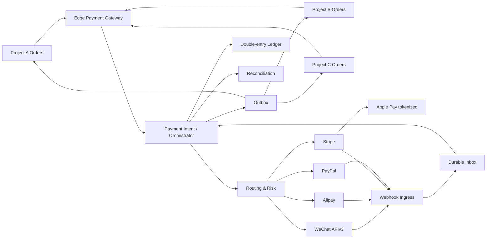

# 参考架构

## 核心原则

平台采用“业务订单分散、支付事实集中”的多项目架构。业务系统创建业务订单后，只向支付平台创建 Payment Intent；支付平台不理解商品库存和履约细节。支付成功通过签名事件返回业务系统。

## 推荐部署单元

1. `edge-gateway`：外部 API、鉴权、签名、限流、WAF 上下文和请求规范化。
2. `payment-core`：Payment Intent、Attempt、授权捕获、退款和状态机。
3. `webhook-ingress`：渠道独立入口、原始体保留、签名验证、Inbox 和快速应答。
4. `provider-connectors`：微信、支付宝、Stripe、PayPal、Apple Pay/PSP 适配器；无业务订单访问权。
5. `merchant-config`：租户、项目、商户账户、凭证引用、能力和路由配置。
6. `risk-engine`：规则、信号、模型接口、案件和处置。
7. `ledger-service`：复式账本、费用、汇率、结算视图和不可变审计。
8. `reconciliation-service`：渠道账单、银行文件、逐笔/汇总核对和差错工单。
9. `webhook-delivery`：向业务项目签名投递、重试、死信和回放。
10. `checkout-web`：托管收银台、支付链接、二维码和严格浏览器安全控制。
11. `admin-api/admin-web`：运营、财务、风控与安全后台；强制 WebAuthn 和职责分离。
12. `worker-scheduler`：账单下载、对账、补偿查询、证书到期、数据保留和运营任务。

在早期可将 2、5、6、7 作为同一代码库中的强模块部署，但数据库表所有权、事件边界和依赖规则必须从第一天保持可拆分。

## 数据与一致性

- PostgreSQL 是支付状态、幂等、Inbox/Outbox 和账本的事实源。
- Kafka 用于可重放事件，不承诺传输层恰好一次；业务效果由 Inbox 唯一约束和事务实现。
- Redis 仅保存限流、短期缓存和可丢失信号，不保存支付最终状态、账本余额或唯一幂等记录。
- 外部调用与本地事务之间通过状态机、Attempt、不确定状态和主动查询恢复，不使用跨 PSP 分布式事务。

## 卡数据范围

Stripe 卡支付使用 Elements/Payment Element 或移动 PaymentSheet；PayPal 使用官方 SDK；Apple Pay 默认把 token 直接交给 PSP。平台不得接收原始 PAN/CVV。若某客户要求直接解密 Apple Pay token，必须创建独立 PCI 扩围部署和 HSM 方案，不能复用默认环境。

## 默认性能与可靠性目标

- 核心 API 在无渠道等待时 p95 < 200ms，p99 < 500ms。
- Webhook 验签与持久化 p95 < 500ms，业务处理异步完成。
- 可用性目标按部署档位设置：核心生产建议月度 99.95%，结算/报表 99.9%。
- 默认 RPO ≤ 5 分钟、RTO ≤ 30 分钟；账本和支付状态应配置更严的同步/半同步策略并由 B94/B95 证明。
- 所有数字只是初始 SLO，必须通过 B103 容量模型和真实业务峰值校准。
