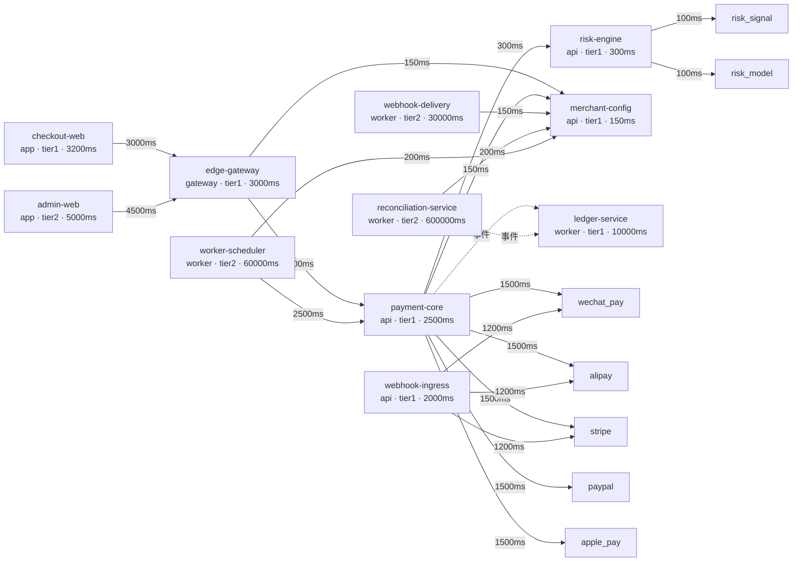

<!-- GENERATED FILE — do not edit by hand.
     Source of truth: governance/service-topology.json
     Regenerate with: python3 scripts/render-topology.py -->

# 服务拆分与依赖规则（B14）

本文由 `governance/service-topology.json` 生成。模块注册表（B00）说的是**构建期**依赖，本文说的是**运行期**依赖：哪些调用是同步的、允许多久、失败时怎么办。

## 全局规则

- 同步调用链最深 **3** 跳
- 预算规则：调用方的预算必须覆盖它所有同步依赖的超时之和；否则超时设置只是装饰，真正生效的是调用方自己先被上游掐断。
- 资金路径失败模式：**fail_closed**。资金路径上的依赖不可用时必须拒绝，不得放行；唯一例外是渠道不可用——那时 attempt 进入 unknown 而不是 failed（AC-01）。
- 数据库访问：`exclusive_per_owner`。服务只能访问自己拥有的表。共享数据库表是分布式单体的定义。

## 拓扑

实线是同步调用（标注超时），虚线是事件（异步）。

## 服务

| 服务 | 形态 | 等级 | 请求预算 | 可用性 | p99 | 同步依赖数 | 异步依赖数 |
| --- | --- | --- | --- | --- | --- | --- | --- |
| `edge-gateway` | gateway | tier1 | 3000ms | 99.99% | 3000ms | 2 | 0 |
| `payment-core` | api | tier1 | 2500ms | 99.95% | 500ms | 7 | 1 |
| `risk-engine` | api | tier1 | 300ms | 99.95% | 150ms | 2 | 0 |
| `merchant-config` | api | tier1 | 150ms | 99.99% | 80ms | 0 | 0 |
| `webhook-ingress` | api | tier1 | 2000ms | 99.99% | 300ms | 3 | 0 |
| `webhook-delivery` | worker | tier2 | 30000ms | 99.9% | 5000ms | 1 | 0 |
| `ledger-service` | worker | tier1 | 10000ms | 99.95% | 2000ms | 0 | 0 |
| `reconciliation-service` | worker | tier2 | 600000ms | 99.5% | 60000ms | 1 | 1 |
| `worker-scheduler` | worker | tier2 | 60000ms | 99.9% | 10000ms | 2 | 0 |
| `checkout-web` | app | tier1 | 3200ms | 99.9% | 1500ms | 1 | 0 |
| `admin-web` | app | tier2 | 5000ms | 99.5% | 2000ms | 1 | 0 |

## 依赖与降级

| 调用方 | 被调方 | 方式 | 超时 | 重试 | 被调方不可用时 |
| --- | --- | --- | --- | --- | --- |
| `edge-gateway` | `payment-core` | sync | 2500ms | 0 | 返回 provider_unavailable(502)，不生成任何支付事实 |
| `edge-gateway` | `merchant-config` | sync | 150ms | 1 | 使用本地缓存的商户配置，缓存过期则拒绝请求 |
| `payment-core` | `risk-engine` | sync | 300ms | 0 | **失败关闭**：风控不可用时拒绝授权，不放行 |
| `payment-core` | `merchant-config` | sync | 150ms | 1 | 使用本地缓存的渠道账户配置，缓存过期则拒绝 |
| `payment-core` | `wechat-pay` | sync | 1500ms | 0 | attempt 进入 unknown，交由对账与主动查询定责——**绝不判失败** |
| `payment-core` | `alipay` | sync | 1500ms | 0 | attempt 进入 unknown，交由对账与主动查询定责——**绝不判失败** |
| `payment-core` | `stripe` | sync | 1500ms | 0 | attempt 进入 unknown，交由对账与主动查询定责——**绝不判失败** |
| `payment-core` | `paypal` | sync | 1500ms | 0 | attempt 进入 unknown，交由对账与主动查询定责——**绝不判失败** |
| `payment-core` | `apple-pay` | sync | 1500ms | 0 | attempt 进入 unknown，交由对账与主动查询定责——**绝不判失败** |
| `payment-core` | `ledger-service` | async | — | — | 账本落后不阻塞支付；差异由对账兜底 |
| `risk-engine` | `risk-signal` | sync | 100ms | 0 | 返回可解释 REVIEW，禁止静默批准 |
| `risk-engine` | `risk-model` | sync | 100ms | 0 | 返回可解释 REVIEW，禁止静默批准 |
| `webhook-ingress` | `wechat-pay` | sync | 1200ms | 1 | 回调先落盘再定责；查询失败不影响回执 |
| `webhook-ingress` | `alipay` | sync | 1200ms | 1 | 回调先落盘再定责；查询失败不影响回执 |
| `webhook-ingress` | `stripe` | sync | 1200ms | 1 | 回调先落盘再定责；查询失败不影响回执 |
| `webhook-delivery` | `merchant-config` | sync | 150ms | 1 | 使用缓存的订阅配置；缓存过期则暂停投递而不是乱投 |
| `reconciliation-service` | `merchant-config` | sync | 200ms | 2 | 缓存的渠道账户配置；过期则跳过该渠道并产生对账例外 |
| `reconciliation-service` | `ledger-service` | async | — | — | 账本数据缺失时产生对账例外，而不是静默跳过 |
| `worker-scheduler` | `payment-core` | sync | 2500ms | 0 | 任务重排到下一个窗口，不重复发起支付 |
| `worker-scheduler` | `merchant-config` | sync | 200ms | 1 | 缓存的调度配置；过期则暂停该租户的调度 |
| `checkout-web` | `edge-gateway` | sync | 3000ms | 0 | 展示「支付处理中」并轮询状态，**不得**自行判定成功 |
| `admin-web` | `edge-gateway` | sync | 4500ms | 0 | 只读降级；写操作保持 UNKNOWN/PENDING，禁止宣称领域效果已完成 |

## 预算核算

| 服务 | 同步超时之和 | 自身预算 | 余量 |
| --- | --- | --- | --- |
| `edge-gateway` | 2650ms | 3000ms | 350ms |
| `payment-core` | 7950ms | 2500ms | -5450ms |
| `risk-engine` | 200ms | 300ms | 100ms |
| `merchant-config` | 0ms | 150ms | 150ms |
| `webhook-ingress` | 3600ms | 2000ms | -1600ms |
| `webhook-delivery` | 150ms | 30000ms | 29850ms |
| `ledger-service` | 0ms | 10000ms | 10000ms |
| `reconciliation-service` | 200ms | 600000ms | 599800ms |
| `worker-scheduler` | 2700ms | 60000ms | 57300ms |
| `checkout-web` | 3000ms | 3200ms | 200ms |
| `admin-web` | 4500ms | 5000ms | 500ms |

## 边界说明

- **`edge-gateway`**：网关不拥有支付、风控或发布领域事实；它只写自身拥有的鉴权重放、幂等、审计和 admin_domain_command 信封/回执查询状态。领域命令效果必须由所属服务在本地事务中应用，网关不得跨所有者直写。
- **`payment-core`**：支付核心是唯一能写支付事实的服务。它同步依赖的只有风控、商户配置与渠道；账本、对账、对外投递全部异步。
- **`risk-engine`**：风控在支付关键路径上，规则与决策持久化由自身表拥有；edge 对 nonce 与 decision 共用单个 300ms 单调时钟截止时间，禁止每跳重启预算；signal/model 仅通过 TLS 1.3 mTLS 精确服务出口访问且各限 100ms，任一依赖不确定时返回可解释 REVIEW。
- **`merchant-config`**：配置服务是叶子节点：它不同步依赖任何其他服务，否则整棵调用树的可用性会被它的依赖拖垮。
- **`webhook-ingress`**：入站回调必须先验签再落盘，落盘之后才回执。先回执后落盘会让渠道以为送达了。
- **`webhook-delivery`**：对外投递是异步工作进程，它的慢不会传导回支付关键路径。
- **`ledger-service`**：账本只消费事件，不被同步调用。这让「账本慢」永远不等于「支付失败」。
- **`reconciliation-service`**：对账是批处理，预算以分钟计；它兜住所有 unknown 与差异。
- **`worker-scheduler`**：调度器的重试必须是幂等的：它调用的每个支付核心接口都要求幂等键。
- **`checkout-web`**：收银台是浏览器里的东西，它的任何状态都不是支付依据（NN-03）。（流量物理上经过 edge-gateway，但依赖的是 payment-core 的 API 契约。）
- **`admin-web`**：后台不得绕过领域所有者直接改支付、退款、风控或发布状态（FF-02）。Admin Action API 只创建摘要绑定的命令信封；领域消费者必须在效果、回执和 APPLIED 状态同一事务中提交。

共 11 个部署单元、20 条同步边、2 条异步边。
