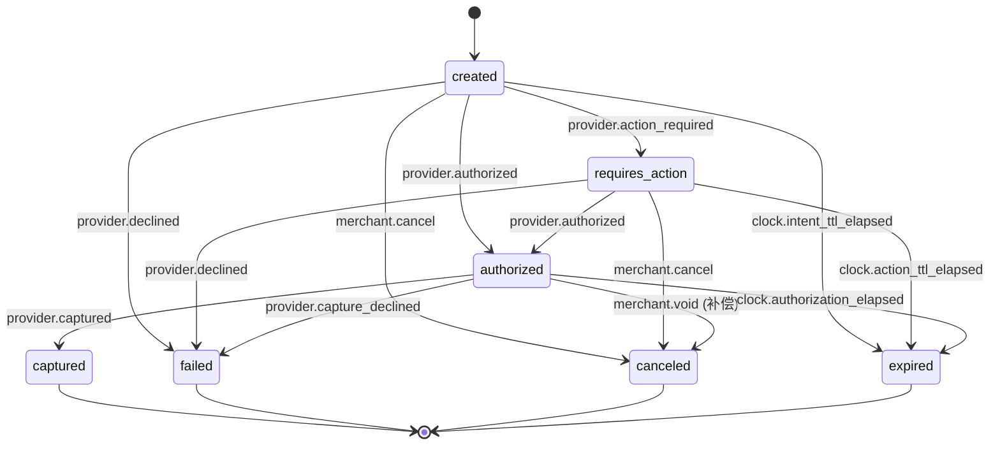
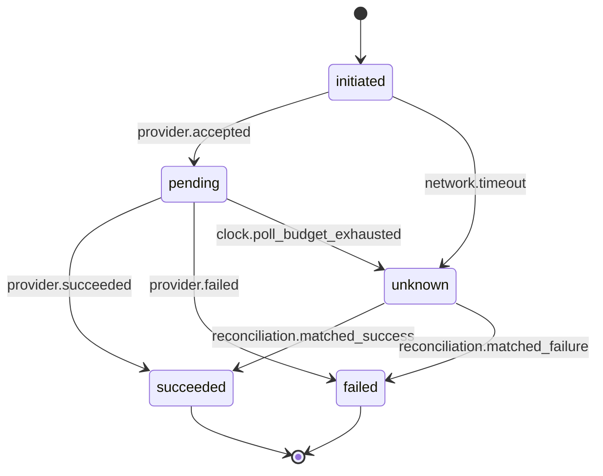
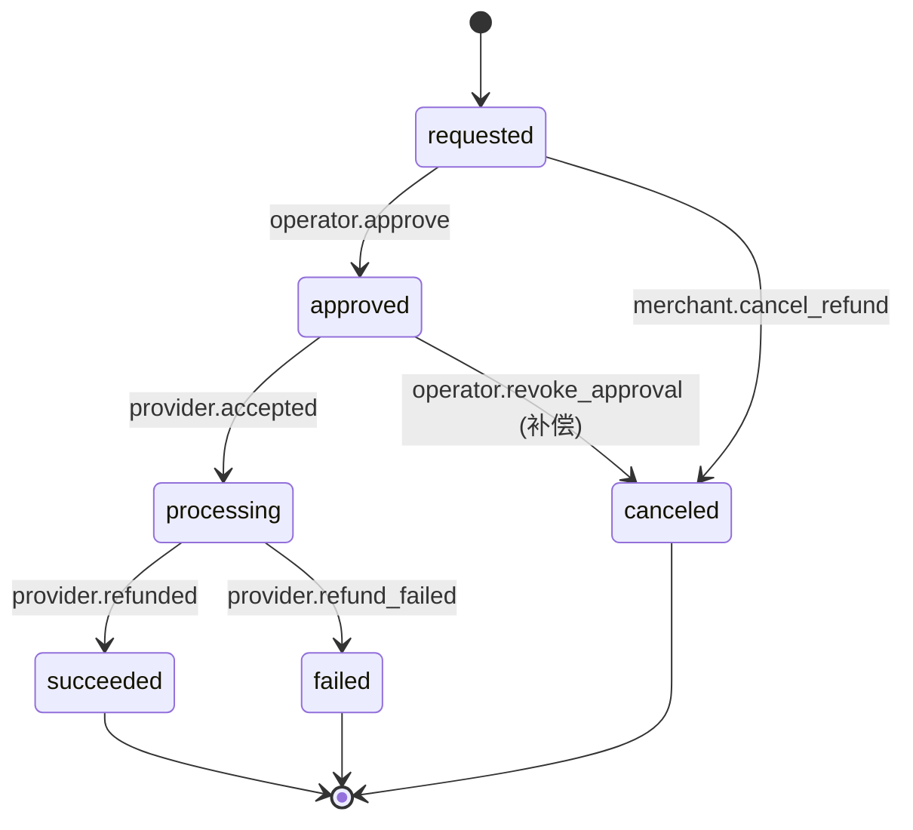
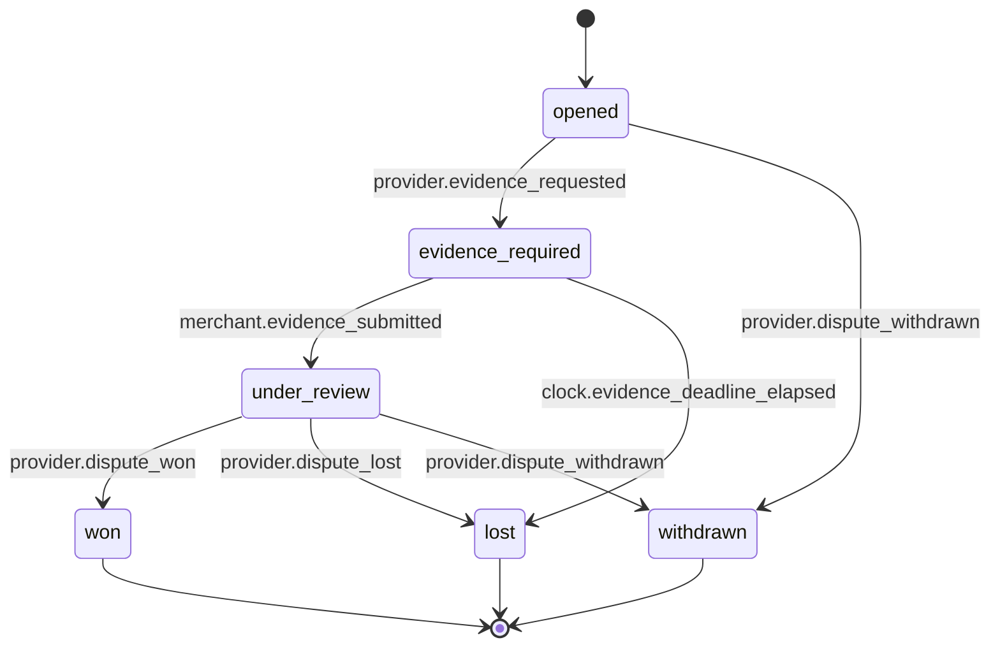
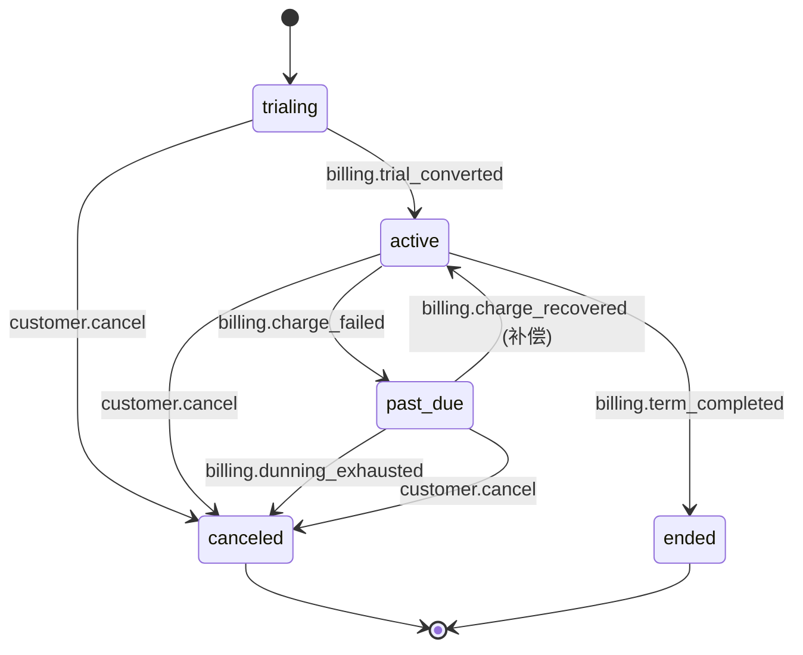
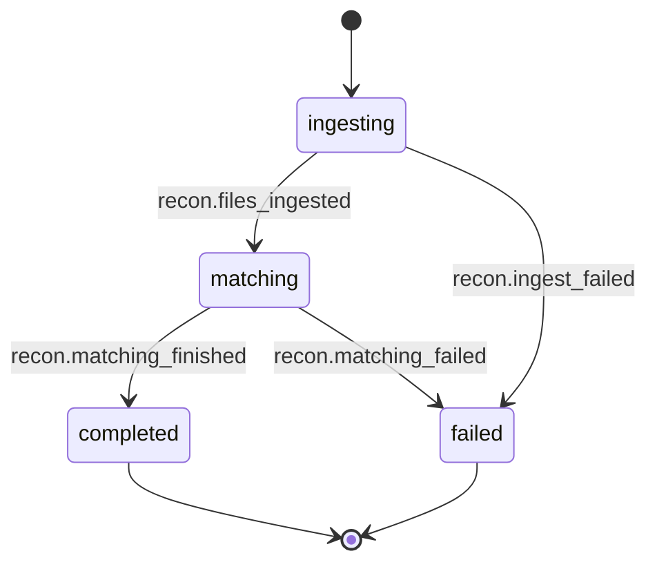
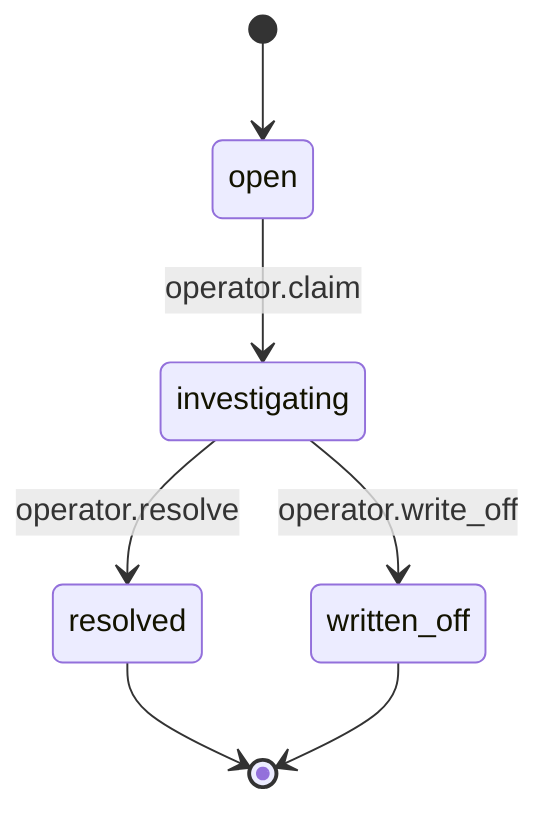

<!-- GENERATED FILE — do not edit by hand.
     Source of truth: governance/state-machines.json
     Regenerate with: python3 scripts/render-states.py -->

# 支付状态机与业务不变量（B10）

本文由 `governance/state-machines.json` 生成。状态集合本身来自 `governance/domain-model.json`（B08），本文只负责**转移**。

## 参与者与信任边界

| 参与者 | 说明 | 可否写入成功状态 |
| --- | --- | --- |
| `provider-event` | 已验签的渠道回调事件或服务端主动查询结果 | ✅ 可以 |
| `merchant` | 商户经由平台 API 发起的动作 | ❌ 不可以 |
| `customer` | 终端用户动作 | ❌ 不可以 |
| `operator` | 平台运营人员经后台发起的动作 | ❌ 不可以 |
| `scheduler` | 平台调度器（超时、账期、催缴） | ❌ 不可以 |
| `system` | 平台内部技术事件（网络超时等） | ❌ 不可以 |
| `reconciliation` | 对账定责结果 | ✅ 可以 |

> 只有已验签渠道事件与服务端主动查询/对账结果可以写入成功状态（NN-03）。客户端回跳、同步返回页、未验签通知一律不行——这条在 `STATE_UNTRUSTED_SUCCESS` 里是可执行的规则，不是这段文字。

## 成功状态清单

- **PaymentAttempt**：`succeeded`
- **PaymentIntent**：`authorized`, `captured`
- **Refund**：`succeeded`

## payment-intent — PaymentIntent

退款不改变 PaymentIntent 状态：已捕获仍是已捕获，退款金额记在 refunded_amount_minor 上。这是刻意的——把「已退款」做成支付状态会让部分退款无法表达。

初始状态 `created`；终态 `captured`, `failed`, `canceled`, `expired`。

| 从 | 到 | 事件 | 参与者 | 类型 | 守卫 | 幂等键 | 效果 |
| --- | --- | --- | --- | --- | --- | --- | --- |
| `created` | `requires_action` | `provider.action_required` | `provider-event` | forward | 渠道返回需要持卡人完成 3DS/跳转等动作；仅凭已验签事件写入 | `provider_event_id` | 记录 attempt、下发 action 参数 |
| `created` | `authorized` | `provider.authorized` | `provider-event` | forward | 已验签渠道事件或服务端主动查询确认授权成功（NN-03） | `provider_event_id` | 写入 authorized_at、登记授权账目 |
| `created` | `failed` | `provider.declined` | `provider-event` | forward | 仅当 B33 渠道结果分类明确 settles_intent=true 时才进入 failed；普通 card_declined/instrument_declined 只结束 attempt，PaymentIntent 保持可用 | `provider_event_id` | 记录失败原因码 |
| `created` | `canceled` | `merchant.cancel` | `merchant` | forward | 商户在授权前主动取消；无资金影响 | `idempotency_key` | 写入 canceled_at |
| `created` | `expired` | `clock.intent_ttl_elapsed` | `scheduler` | forward | 超过 intent TTL 仍未授权；由调度器而非用户请求触发 | `intent_id+ttl_epoch` | 写入 expired_at |
| `requires_action` | `authorized` | `provider.authorized` | `provider-event` | forward | 持卡人完成动作后渠道确认授权（NN-03） | `provider_event_id` | 写入 authorized_at |
| `requires_action` | `failed` | `provider.declined` | `provider-event` | forward | 持卡人动作后的拒绝只有在 B33 分类明确 settles_intent=true 时才进入 failed；可更换资金源的拒绝只结束 attempt | `provider_event_id` | 记录失败原因码 |
| `requires_action` | `canceled` | `merchant.cancel` | `merchant` | forward | 商户放弃这笔意图 | `idempotency_key` | 写入 canceled_at |
| `requires_action` | `expired` | `clock.action_ttl_elapsed` | `scheduler` | forward | 持卡人动作超过 action TTL 仍未完成，渠道不再受理 | `intent_id+ttl_epoch` | 写入 expired_at |
| `authorized` | `captured` | `provider.captured` | `provider-event` | forward | 已验签捕获事件；captured_amount_minor <= amount_minor（NN-05） | `provider_event_id` | 写入 captured_at、记账：授权转已捕获 |
| `authorized` | `canceled` | `merchant.void` | `merchant` | compensating | 授权撤销（void）：补偿式回到无资金占用，不是把捕获退回 | `idempotency_key` | 释放授权额度、记账：冲销授权 |
| `authorized` | `expired` | `clock.authorization_elapsed` | `scheduler` | forward | 授权有效期到期而未捕获，渠道自动释放 | `intent_id+ttl_epoch` | 记账：冲销授权 |
| `authorized` | `failed` | `provider.capture_declined` | `provider-event` | forward | 捕获被渠道拒绝且不可重试 | `provider_event_id` | 记录失败原因码 |

## payment-attempt — PaymentAttempt

`unknown` 是一等状态而不是错误，也不是终态——它必须被对账或主动查询定责。支付系统最危险的默认是把超时当失败，那正是重复扣款的来源（AC-01）。

初始状态 `initiated`；终态 `succeeded`, `failed`。

| 从 | 到 | 事件 | 参与者 | 类型 | 守卫 | 幂等键 | 效果 |
| --- | --- | --- | --- | --- | --- | --- | --- |
| `initiated` | `pending` | `provider.accepted` | `provider-event` | forward | 渠道受理请求但未定责 | `attempt_id` | — |
| `initiated` | `unknown` | `network.timeout` | `system` | forward | 请求超时且无法判断渠道是否已受理——**不得**当作失败（AC-01） | `attempt_id` | 排入主动查询队列 |
| `pending` | `succeeded` | `provider.succeeded` | `provider-event` | forward | 已验签事件或服务端查询确认成功（NN-03） | `provider_event_id` | — |
| `pending` | `failed` | `provider.failed` | `provider-event` | forward | 渠道明确失败 | `provider_event_id` | — |
| `pending` | `unknown` | `clock.poll_budget_exhausted` | `scheduler` | forward | 轮询预算耗尽仍未定责，转人工/对账 | `attempt_id+poll_epoch` | 产生对账例外 |
| `unknown` | `succeeded` | `reconciliation.matched_success` | `reconciliation` | forward | 对账或主动查询把未知定责为成功 | `provider_event_id` | 回填 PaymentIntent |
| `unknown` | `failed` | `reconciliation.matched_failure` | `reconciliation` | forward | 对账或主动查询把未知定责为失败 | `provider_event_id` | — |

## refund — Refund

没有 succeeded→canceled：钱已经离开就不能靠改状态收回，必须走新的收款流程。

初始状态 `requested`；终态 `succeeded`, `failed`, `canceled`。

| 从 | 到 | 事件 | 参与者 | 类型 | 守卫 | 幂等键 | 效果 |
| --- | --- | --- | --- | --- | --- | --- | --- |
| `requested` | `approved` | `operator.approve` | `operator` | forward | 退款审批；审批人不得是发起人（NN-11 职责分离） | `refund_id` | 写入审计事件 |
| `requested` | `canceled` | `merchant.cancel_refund` | `merchant` | forward | 退款在提交渠道前被撤回 | `idempotency_key` | — |
| `approved` | `processing` | `provider.accepted` | `provider-event` | forward | 渠道受理退款请求并返回受理凭据 | `refund_id` | — |
| `approved` | `canceled` | `operator.revoke_approval` | `operator` | compensating | 审批在提交渠道前被撤销 | `refund_id` | 写入审计事件 |
| `processing` | `succeeded` | `provider.refunded` | `provider-event` | forward | 已验签退款成功事件；累计退款 <= 已捕获金额（NN-05） | `provider_event_id` | 记账：退款出账、累加 refunded_amount_minor |
| `processing` | `failed` | `provider.refund_failed` | `provider-event` | forward | 渠道退款失败；资金未离开，允许重新发起新的退款单 | `provider_event_id` | — |

## dispute — Dispute

争议状态一律由渠道事件驱动，平台没有自行裁定的转移——这是刻意的边界。

初始状态 `opened`；终态 `won`, `lost`, `withdrawn`。

| 从 | 到 | 事件 | 参与者 | 类型 | 守卫 | 幂等键 | 效果 |
| --- | --- | --- | --- | --- | --- | --- | --- |
| `opened` | `evidence_required` | `provider.evidence_requested` | `provider-event` | forward | 渠道要求商户举证，带举证截止时间 | `provider_event_id` | 冻结相关资金、创建举证任务 |
| `opened` | `withdrawn` | `provider.dispute_withdrawn` | `provider-event` | forward | 持卡人主动撤回争议，渠道通知撤案 | `provider_event_id` | 解冻资金 |
| `evidence_required` | `under_review` | `merchant.evidence_submitted` | `merchant` | forward | 举证材料已提交渠道 | `dispute_id+evidence_revision` | 写入审计事件 |
| `evidence_required` | `lost` | `clock.evidence_deadline_elapsed` | `scheduler` | forward | 举证超时视同败诉——沉默不是中立（AC-06） | `dispute_id+deadline_epoch` | 记账：争议扣款 |
| `under_review` | `won` | `provider.dispute_won` | `provider-event` | forward | 渠道裁定商户胜诉 | `provider_event_id` | 解冻资金、记账：争议资金返还 |
| `under_review` | `lost` | `provider.dispute_lost` | `provider-event` | forward | 渠道裁定商户败诉 | `provider_event_id` | 记账：争议扣款 |
| `under_review` | `withdrawn` | `provider.dispute_withdrawn` | `provider-event` | forward | 裁定前持卡人撤回 | `provider_event_id` | 解冻资金 |

## subscription — Subscription

past_due→active 是本模型里唯一的补偿式回边，因为账期本身允许补救。

初始状态 `trialing`；终态 `canceled`, `ended`。

| 从 | 到 | 事件 | 参与者 | 类型 | 守卫 | 幂等键 | 效果 |
| --- | --- | --- | --- | --- | --- | --- | --- |
| `trialing` | `active` | `billing.trial_converted` | `scheduler` | forward | 试用期结束且首期扣款成功 | `subscription_id+period` | 创建 PaymentIntent |
| `trialing` | `canceled` | `customer.cancel` | `customer` | forward | 用户在试用期内取消，尚未产生任何扣款 | `idempotency_key` | — |
| `active` | `past_due` | `billing.charge_failed` | `scheduler` | forward | 周期扣款失败，进入宽限重试 | `subscription_id+period` | 排入重试计划 |
| `active` | `canceled` | `customer.cancel` | `customer` | forward | 用户主动取消，服务持续到本周期末 | `idempotency_key` | — |
| `active` | `ended` | `billing.term_completed` | `scheduler` | forward | 固定期数订阅正常结束 | `subscription_id+period` | — |
| `past_due` | `active` | `billing.charge_recovered` | `scheduler` | compensating | 宽限期内补扣成功，恢复正常——这是补偿式回边，必须显式声明 | `subscription_id+period` | 清除重试计划 |
| `past_due` | `canceled` | `billing.dunning_exhausted` | `scheduler` | forward | 催缴用尽仍未成功 | `subscription_id+period` | 写入审计事件 |
| `past_due` | `canceled` | `customer.cancel` | `customer` | forward | 用户在催缴期间主动取消 | `idempotency_key` | — |

## reconciliation-run — ReconciliationRun

completed 不代表「全部对上」，只代表「全部有交代」。

初始状态 `ingesting`；终态 `completed`, `failed`。

| 从 | 到 | 事件 | 参与者 | 类型 | 守卫 | 幂等键 | 效果 |
| --- | --- | --- | --- | --- | --- | --- | --- |
| `ingesting` | `matching` | `recon.files_ingested` | `scheduler` | forward | 渠道对账文件全部落地且校验通过 | `run_id` | — |
| `ingesting` | `failed` | `recon.ingest_failed` | `scheduler` | forward | 文件缺失或校验失败 | `run_id` | 告警 |
| `matching` | `completed` | `recon.matching_finished` | `scheduler` | forward | 匹配结束；未匹配项一律生成对账例外，不允许静默丢弃 | `run_id` | 生成 ReconciliationException |
| `matching` | `failed` | `recon.matching_failed` | `scheduler` | forward | 匹配过程异常终止 | `run_id` | 告警 |

## reconciliation-exception — ReconciliationException

没有 open→resolved 的直达路径：任何差异都必须先被人认领，留下责任人。

初始状态 `open`；终态 `resolved`, `written_off`。

| 从 | 到 | 事件 | 参与者 | 类型 | 守卫 | 幂等键 | 效果 |
| --- | --- | --- | --- | --- | --- | --- | --- |
| `open` | `investigating` | `operator.claim` | `operator` | forward | 运营认领该对账例外并成为责任人 | `exception_id` | 写入审计事件 |
| `investigating` | `resolved` | `operator.resolve` | `operator` | forward | 找到原因并完成修复动作 | `exception_id` | 写入审计事件、记账：差异修复 |
| `investigating` | `written_off` | `operator.write_off` | `operator` | forward | 经审批核销；核销人不得是认领人（NN-11） | `exception_id` | 写入审计事件、记账：核销 |

---

共 7 台状态机、48 条转移，全部带守卫与幂等键。
