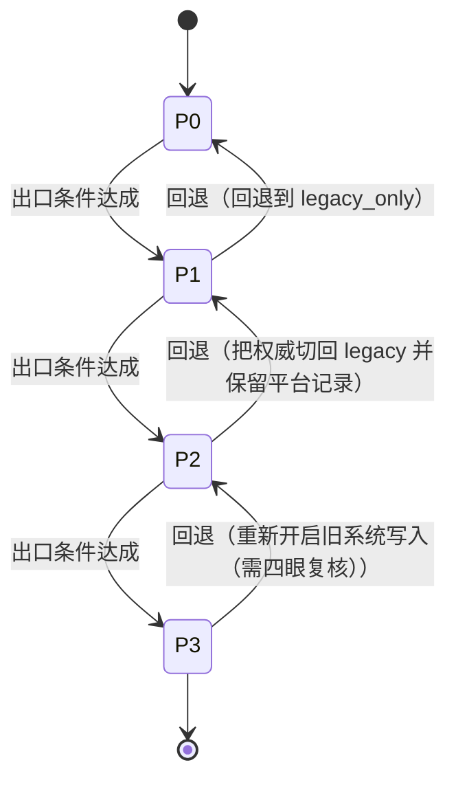

<!-- GENERATED FILE — do not edit by hand.
     Source of truth: governance/migration-plan.json
     Regenerate with: python3 scripts/render-migration.py -->

# 现有项目订单迁移架构（B15）

业务订单留在原项目，只迁移支付事实与支付动作。平台永远不知道商品、库存与履约，这是 NN-01 在迁移期的具体形态。

## 所有权切分

| 留在原项目 | 迁到支付平台 |
| --- | --- |
| `business_order` | `payment_intent` |
| `order_item` | `payment_attempt` |
| `sku` | `refund` |
| `inventory` | `dispute` |
| `fulfilment` | `subscription` |
| `shipping_address` | `ledger_transaction` |
| `customer_profile` | `ledger_entry` |
| `promotion` | `recon_run` |
| `invoice_content` | `recon_exception` |

两侧只通过 `external_reference` 绑定，唯一性为 `project_id`、`external_reference`。平台与旧系统之间只通过 (project_id, external_reference) 绑定。平台不存业务订单号以外的任何订单信息，也不反向查询旧系统的库。

**旧库访问**：平台的任何服务都不得连接旧系统数据库（FF-01）。需要的业务上下文由适配层在调用时传入，且只限于绑定字段与金额。

## 适配层

归属 `legacy-project`，位置：旧系统内，不在平台仓库。适配层住在旧系统里，由旧系统的团队拥有。把适配层放进平台仓库会让平台再次开始理解订单，那正是要避免的事。

| 旧系统动作 | 平台操作 | 幂等键来源 | 透传字段 |
| --- | --- | --- | --- |
| 创建支付 | `create_payment_intent` | `external_reference` | `project_id`、`external_reference`、`amount_minor`、`currency` |
| 捕获 | `capture_payment_intent` | `external_reference` | `payment_intent_id` |
| 取消 | `cancel_payment_intent` | `external_reference` | `payment_intent_id` |
| 退款 | `create_refund` | `external_reference` | `payment_intent_id`、`amount_minor`、`currency` |

**禁止透传**：`sku`、`item`、`quantity`、`inventory`、`stock`、`shipping_address`、`product_name`、`coupon`

## 双写

**每笔支付对渠道的调用次数：1**。双写是**双记录**，不是双扣款。任何一期里，一笔支付对渠道的调用只有一次；非权威侧写的是同一笔事实的镜像，它不持有幂等键，也不发起渠道请求。

- 比对字段：`amount_minor`、`currency`、`status`、`external_reference`
- 比对窗口：15 分钟；分歧预算：0.1%
- 分歧落库：`recon_exception`
- 中止规则：分歧率超预算或出现任何金额类分歧时，立即停止推进并回退到上一期

## 历史回填

- 来源：legacy 只读副本（只读：True）
- 幂等：True；可续跑：True（断点字段 `legacy_payment_id`）
- 校验：count_by_day、sum_amount_minor_by_currency、random_sample_1000；容差：零容差：任何一天的笔数或金额不一致即失败

回填必须可重跑、可断点续跑，且对旧系统只读。校验用总额而不是抽样——抽样能证明存在，证明不了守恒。

## 切换与 kill switch

- 粒度：`project`
- kill switch：作用域 `per_project`，60 秒内生效，需审计事件

按项目逐个切换，不做全局切换。kill switch 必须能在 60 秒内把一个项目切回上一期，并留下审计事件。

## 阶段

### P0 — 只读影子

写入模式 `legacy_only`；支付事实权威方 **legacy**。

平台只观察不动手：接收适配层的只读镜像调用，验证映射与状态推导，**绝不调用渠道**。这一期的唯一目的是证明映射是对的。

| | |
| --- | --- |
| 进入条件 | 平台已部署且可接收适配层调用；已完成一个项目的字段映射评审 |
| 退出条件 | 影子流量覆盖率 ≥ 95%；连续 7 天零字段映射错误 |
| 回退动作 | 关闭影子流量 |
| 回退是否保全支付事实 | 是（影子期平台不发起任何渠道调用，关掉它不影响任何资金事实） |
| 证据闸门 | `evidence/B15/runtime/migration-smoke.log` |

### P1 — 双写·旧系统权威

写入模式 `dual_write_legacy_authoritative`；支付事实权威方 **legacy**。

双写指的是**双记录**，不是双扣款：渠道调用仍然只由旧系统发起一次，平台记录的是同一笔事实的镜像。这一点是本批次最重要的约束。

| | |
| --- | --- |
| 进入条件 | P0 出口条件全部满足；分歧检测已上线；kill switch 已演练 |
| 退出条件 | 分歧率 < 0.1% 且连续 14 天无资金类分歧；对账连续 14 天平 |
| 回退动作 | 回退到 legacy_only |
| 回退是否保全支付事实 | 是（平台侧记录保留为只读历史，不删除；旧系统始终是权威，回退无资金影响） |
| 证据闸门 | `evidence/B15/runtime/dual-write-divergence.log` |

### P2 — 双写·平台权威

写入模式 `dual_write_platform_authoritative`；支付事实权威方 **platform**。

权威切换后渠道调用由平台发起，旧系统转为镜像。切换粒度是**项目**，不是全局。

| | |
| --- | --- |
| 进入条件 | P1 出口条件全部满足；平台已通过独立审查；回退演练成功 |
| 退出条件 | 平台连续 30 天 SLO 达标；分歧率 < 0.01%；全部渠道已在平台侧完成真实交易 |
| 回退动作 | 把权威切回 legacy 并保留平台记录 |
| 回退是否保全支付事实 | 是（权威位是一个开关，不是一次数据迁移；两侧记录都完整，切回不丢事实） |
| 证据闸门 | `evidence/B15/runtime/dual-write-divergence.log`、`evidence/B15/security/governance-report.json` |

### P3 — 平台单写

写入模式 `platform_only`；支付事实权威方 **platform**。

旧系统的支付代码**保留但停用**至少 90 天。删代码是最后一步，不是第一步。

| | |
| --- | --- |
| 进入条件 | P2 出口条件全部满足；旧系统侧支付代码已标记弃用且不再接收新项目 |
| 退出条件 | 旧系统支付路径连续 90 天零流量；历史数据回填校验通过 |
| 回退动作 | 重新开启旧系统写入（需四眼复核） |
| 回退是否保全支付事实 | 是（旧系统代码保留但停用；重新启用是一个受控操作而不是重新部署） |
| 证据闸门 | `evidence/B15/runtime/backfill-verification.log` |

共 4 期，每期都有进入条件、退出条件、回退动作与证据闸门。
